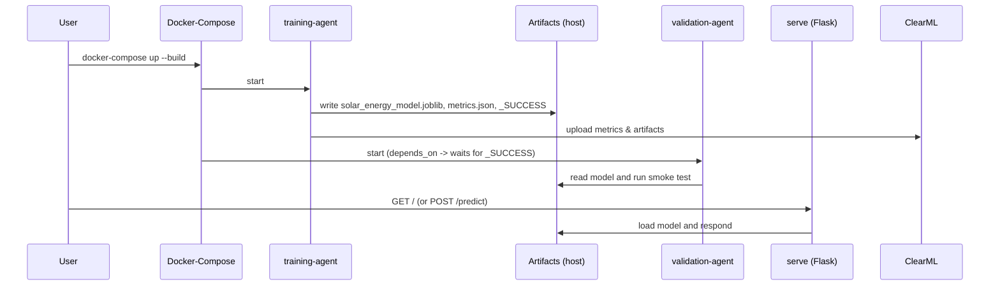
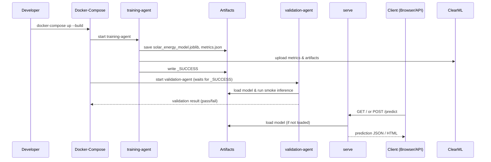
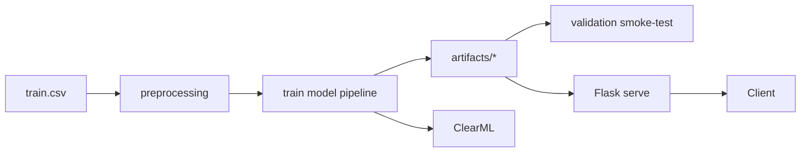

**Solar Energy Prediction — Architecture Design**

## Overview

This document describes the architecture of the Solar Energy Prediction project (training, validation, serving, ClearML integration, and orchestration). It covers components, data flow, deployment model, failure modes, scaling and security considerations.

## Components

- Data Layer
  - `data/train.csv`: CSV dataset with feature columns and `energy_generated` target.
  - `data/data_registry.py`: optional dataset lineage/hashing helper.

- Compute / Pipeline
  - `src/train.py`: training pipeline that builds a sklearn `Pipeline` (StandardScaler + RandomForestRegressor), saves artifacts to `./artifacts`, uploads artifacts and metrics to ClearML, and writes `_SUCCESS` sentinel.
  - `src/validation.py`: loads the saved model and performs a smoke-test inference to validate artifact integrity.
  - `src/sweep.py`: (optional) hyperparameter sweep launcher.

- Serving
  - `src/serve.py`: Flask app that loads the model from `./artifacts` and exposes `GET /`, `GET /health`, and `POST /predict` endpoints. It reads `feature_names_in_` from the pipeline (when available) to ensure correct input ordering.

- Orchestration
  - `docker-compose.yml`: defines services `training-agent`, `validation-agent`, and `serve`.
  - `training-agent` runs `src/train.py` and writes artifacts into the shared volume `./artifacts`.
  - `validation-agent` waits for `./artifacts/_SUCCESS` before running model validation.
  - `serve` mounts `./artifacts` and serves the trained model.

- Observability & Tracking
  - ClearML: `src/train.py` initializes a ClearML `Task`, reports metrics and uploads artifacts.
  - Local artifacts: stored in `./artifacts` for debugging and for the `serve` service to pick up.

## Data Flow

1. Data owner places `train.csv` into `./data`.
2. `training-agent` reads `train.csv`, prepares features and target, trains the pipeline, saves `solar_energy_model.joblib` and `metrics.json`, uploads artifacts to ClearML, and writes `_SUCCESS` sentinel.
3. `validation-agent` (configured to wait on `_SUCCESS`) runs validation to confirm the model loads and inference works. It writes logs to stdout and optionally reports results.
4. `serve` (long-running) loads the artifact from `./artifacts` and responds to prediction requests.

## Sequence Diagram (high-level)



## Deployment Model

- Single-host Docker Compose deployment for development/experiments.
- Production recommendations:
  - Use a dedicated storage (S3, NFS) for artifacts and model registry.
  - Replace Flask dev server with a WSGI server (gunicorn) behind a reverse proxy (nginx).
  - Use Kubernetes for scalable orchestration with jobs for training and validation, and a Deployment/Service for serving.

## Volumes & Files

- Host `./artifacts` is bind-mounted into containers at `/app/artifacts`.
- `./data` is bind-mounted into containers at `/app/data`.

## Scaling & Reliability

- Scale Training:
  - For larger datasets, use distributed training or a bigger instance, and consider using ClearML's remote execution or cloud agents.
- Scale Serving:
  - Host multiple `serve` replicas behind a load balancer.
  - Use a model server (TensorFlow Serving, TorchServe, or a custom gunicorn-wsgi-based server).
- Reliability:
  - Use retry/backoff for validation and monitoring for the `_SUCCESS` sentinel.
  - Add health checks and restart policies for `serve`.

## Security Considerations

- Do not expose the `serve` endpoint publicly without authentication.
- Sanitize inputs and enforce payload size limits.
- Secure ClearML credentials; use secrets managers for production.

## Failure Modes

- Missing `_SUCCESS` → validation never runs.
- Model feature mismatch → prediction errors; mitigate by embedding `feature_names_in_` in the pipeline and validating input schema in `serve`.
- Artifact mount failure → `serve` reports `model_missing`; verify volume mounts.

## Extensibility

- Add CI tests that run `src/train.py` on a small sample dataset and validate predictions.
- Connect `src/sweep.py` to ClearML's hyperparameter optimizer.
- Replace local artifact storage with a model registry (S3 + metadata DB).

## Files

- [docker-compose.yml](docker-compose.yml)
- [src/train.py](src/train.py)
- [src/validation.py](src/validation.py)
- [src/serve.py](src/serve.py)
- [README_FULL.md](README_FULL.md)
- [README_FULL.html](README_FULL.html)

## UML Diagrams (Mermaid)

### Component Diagram

```mermaid
flowchart TD
  subgraph Host
    A[data/train.csv (data)]
    B[./artifacts (model + metrics)]
    C[Docker Compose]
  end

  subgraph Compose
    T[training-agent\n(src/train.py)]
    V[validation-agent\n(src/validation.py)]
    S[serve (Flask)\n(src/serve.py)]
  end

  A --> T
  T --> B
  T -->|upload| ClearML[(ClearML)]
  B --> V
  B --> S
  S -->|HTTP API| Client[User / Client Apps]
  V -->|validation logs| Monitor[(Console / CI)]
  ClearML -->|UI/Experiments| User
```

### Sequence Diagram (training → validation → serving)



### Data Flow (simplified)



You can render these mermaid blocks in Markdown viewers that support Mermaid (VS Code with Mermaid extension, GitHub/other renderers that support mermaid), or export them to images using `mmdc` (mermaid-cli) or a Docker image.
