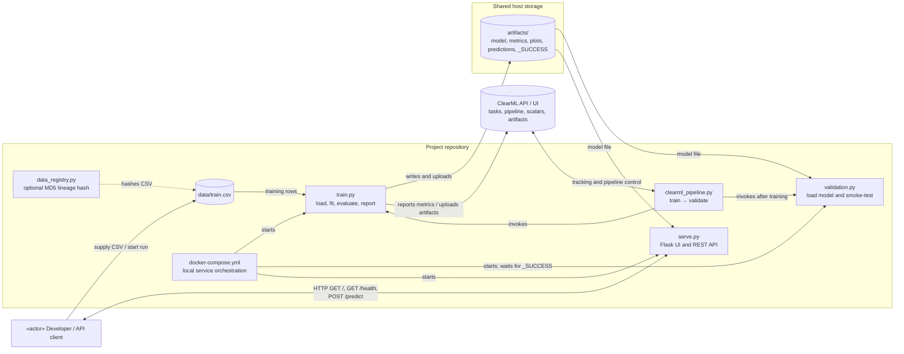
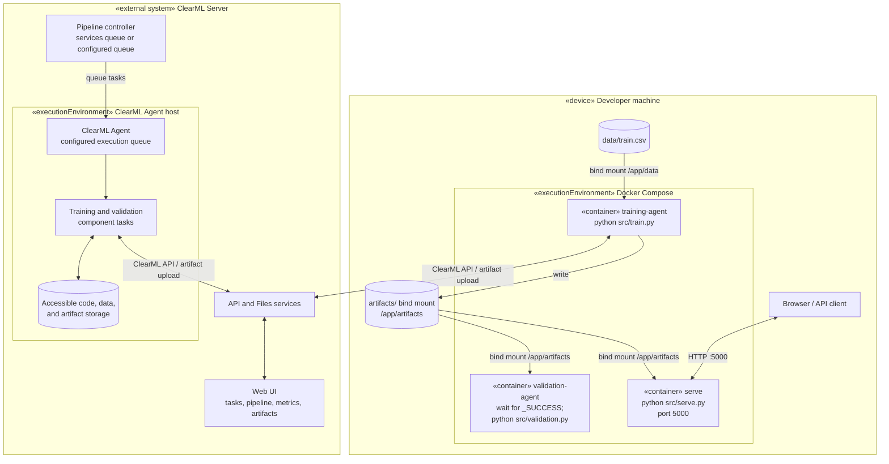
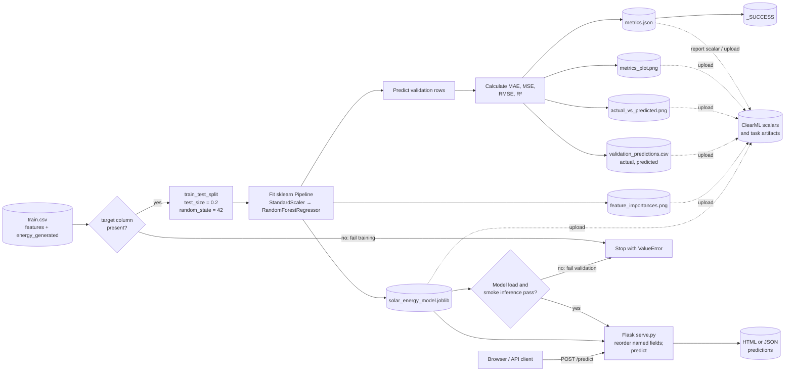
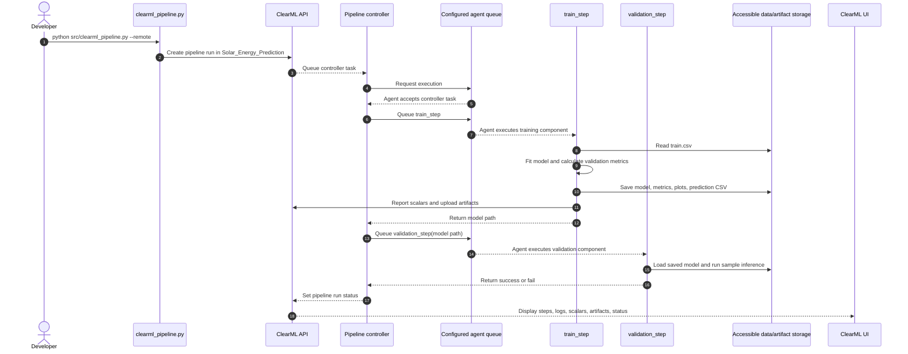
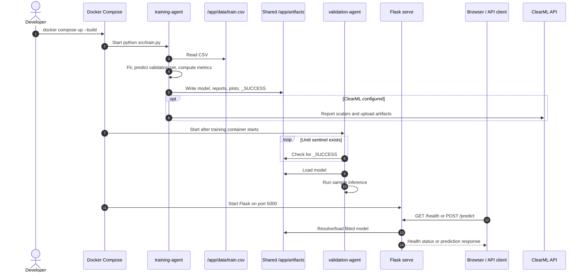
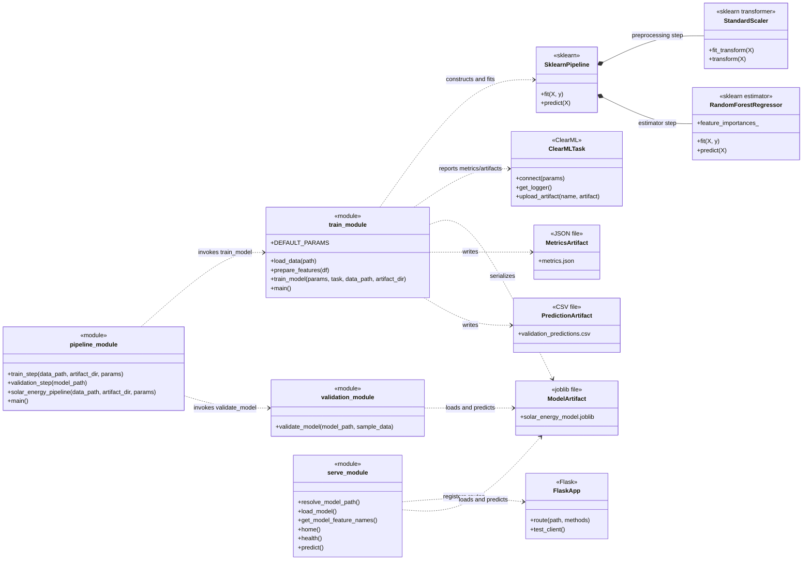
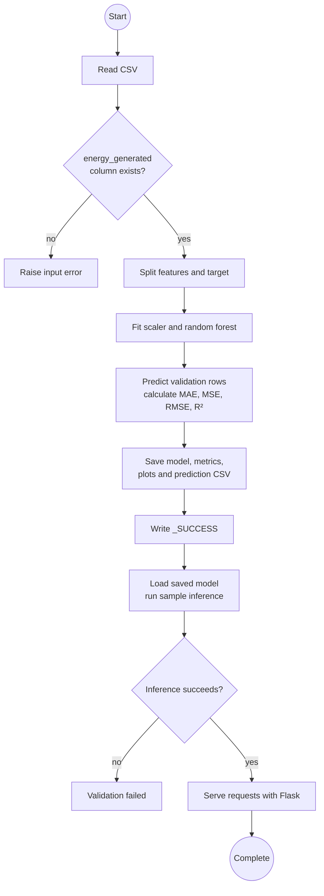

# Solar Energy Prediction — Architecture

## 1. Purpose and scope

This document describes the current repository architecture for data ingestion,
model training, evaluation, validation, prediction serving, and experiment
tracking. Diagrams use Mermaid so they can be rendered by GitHub and compatible
Markdown viewers.

The repository has two orchestration paths:

- **Docker Compose** runs the standalone training script, sentinel-gated
  validation script, and long-running Flask service on one host.
- **ClearML Pipeline** runs the `train_step` and `validation_step` as pipeline
  components. For remote execution, a ClearML Agent must service the configured
  queue, and the agent must be able to access the code, dataset, and artifact
  paths.

These are separate ways to orchestrate training and validation. Running both
against the same artifacts at the same time can cause concurrent writes.

## 2. System context and components

The application predicts `energy_generated` using the features
`temperature`, `humidity`, `solar_irradiance`, `wind_speed`, and `cloud_cover`.
Training and inference share a scikit-learn pipeline containing
`StandardScaler` and `RandomForestRegressor`.

### 2.1 UML component diagram

### 2.2 Component responsibilities

| Component | Responsibility | Inputs | Outputs |
|---|---|---|---|
| `data/train.csv` | Source of labelled training examples | Numeric feature columns and `energy_generated` | Training and validation rows |
| `data/data_registry.py` | Optional dataset lineage helper | CSV path | MD5 hash printed to console |
| `src/train.py` | Fit, evaluate, visualize, and save the model | CSV, parameters, optional ClearML task | Model, metrics, plots, validation predictions, `_SUCCESS` |
| `src/validation.py` | Load a model and verify sample inference | Model path | Pass/fail result and sample prediction |
| `src/clearml_pipeline.py` | Orchestrate training then validation | Dataset/artifact paths and training parameters | ClearML pipeline and component tasks |
| `src/serve.py` | Serve browser UI, health, and prediction routes | HTTP requests and fitted model | HTML or JSON response |
| Docker Compose | Run local training, validation, and serve containers | Compose configuration, mounted data/artifacts | Local running services |
| ClearML | Store run tracking and pipeline metadata | Credentials, scalars, uploaded artifacts | Web UI for task/pipeline inspection |

## 3. UML deployment diagram

This view shows the local Docker Compose deployment and the alternative remote
ClearML Agent deployment. Remote paths must exist or be mounted on the agent;
the local host paths in Docker Compose are not automatically shared with remote
workers.

## 4. Data flow

### 4.1 Training and prediction data-flow diagram

Training currently creates a 20% validation split. It saves validation
predictions as paired `actual` and `predicted` columns. The serving API returns
predictions to clients; it does not currently log live request predictions to
ClearML.

### 4.2 ClearML pipeline sequence

The pipeline controller and components use `CLEARML_EXECUTION_QUEUE`, which
defaults to `default` in `src/clearml_pipeline.py`. A working online ClearML
configuration, an Agent listening on that queue, and shared/available
code/data/artifact paths are required for remote execution.

### 4.3 Local Docker Compose sequence

In Compose, `depends_on` controls service start order; the validation command
also polls for `/app/artifacts/_SUCCESS`. It does not by itself guarantee that
the training container completed successfully.

## 5. UML class and module diagram

The project is primarily functional and does not define custom domain classes.
This UML-style class diagram therefore distinguishes Python modules/functions
from the concrete scikit-learn and Flask classes they use; module boxes are
stereotyped `«module»` rather than presented as Python classes.

## 6. UML activity diagram — model lifecycle

## 7. Artifact and interface contracts

### Training outputs

| Path | Format | Meaning |
|---|---|---|
| `artifacts/solar_energy_model.joblib` | Joblib | Fitted scaler/regressor pipeline |
| `artifacts/metrics.json` | JSON | MAE, MSE, RMSE, R², and parameters |
| `artifacts/metrics_plot.png` | PNG | Validation metric chart |
| `artifacts/actual_vs_predicted.png` | PNG | Actual-vs-predicted validation scatter plot |
| `artifacts/validation_predictions.csv` | CSV | `actual` and `predicted` validation values |
| `artifacts/feature_importances.png` | PNG | Random forest feature-importance chart |
| `artifacts/_SUCCESS` | Text sentinel | Indicates training reached output completion |

### HTTP interface

| Method and path | Purpose | Successful response |
|---|---|---|
| `GET /` | Browser prediction form | HTML |
| `GET /health` | Model readiness check | JSON status |
| `POST /predict` | Predict named feature records | `{"predictions":[...]}` |

The prediction input must provide the model's feature names. The serving code
uses the fitted pipeline's feature order when available. Keep feature schema
changes aligned between the CSV, training process, and request payloads.

## 8. Deployment, reliability, and security

### Current deployment

- Docker Compose is intended for local development and single-host experiments.
- `./data` is mounted at `/app/data`; `./artifacts` is mounted at
  `/app/artifacts`.
- The Flask development server listens on port `5000`.
- ClearML remote pipeline execution is an alternative orchestration route and
  requires an Agent plus storage paths accessible to that Agent.

### Reliability considerations

- A missing dataset or target column stops training.
- A missing model or failed inference causes model validation to fail.
- Compose validation waits for `_SUCCESS`; inspect training logs if it never
  appears.
- A remote agent cannot use a developer's local paths unless those paths are
  mounted or data is transferred through shared/remote storage.
- Use health checks, task timeouts, retries, and artifact versioning when
  evolving this workflow for production.

### Security and production notes

- Store ClearML credentials in environment-backed secrets, not source files,
  documentation, or container images.
- Do not expose the prediction service publicly without authentication,
  request-size limits, and input validation.
- Flask's built-in development server is not production-grade; use a production
  WSGI server behind an appropriately configured reverse proxy.
- Restrict artifact access and avoid loading untrusted serialized model files.

## 9. Extension points

- Add schema validation and dataset quality checks before training.
- Register promoted models and use versioned object storage for artifacts.
- Add prediction logging with privacy-aware retention if operational inference
  monitoring is required.
- Add automated tests for input validation, model loading, and API behavior.
- Add ClearML hyperparameter optimization around the existing training
  parameters.

## 10. Related files

- [README.md](README.md)
- [docker-compose.yml](docker-compose.yml)
- [Dockerfile](Dockerfile)
- [src/train.py](src/train.py)
- [src/validation.py](src/validation.py)
- [src/clearml_pipeline.py](src/clearml_pipeline.py)
- [src/serve.py](src/serve.py)
- [data/data_registry.py](data/data_registry.py)
